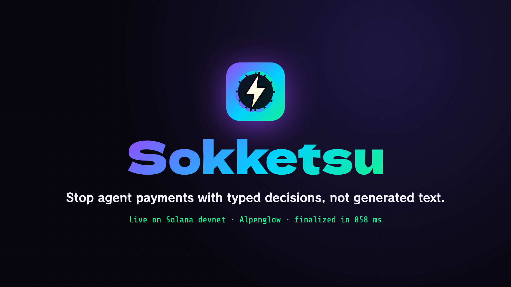
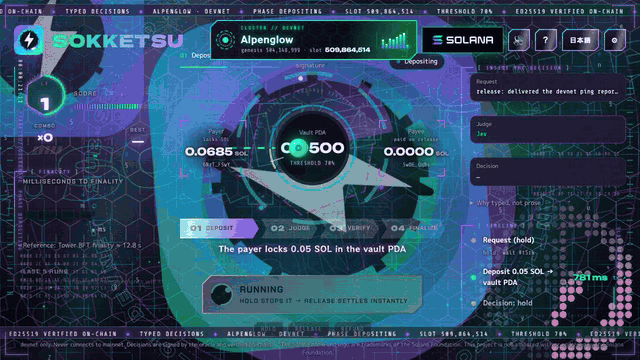
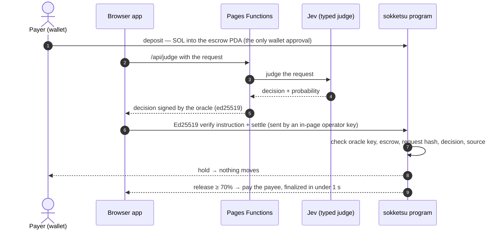
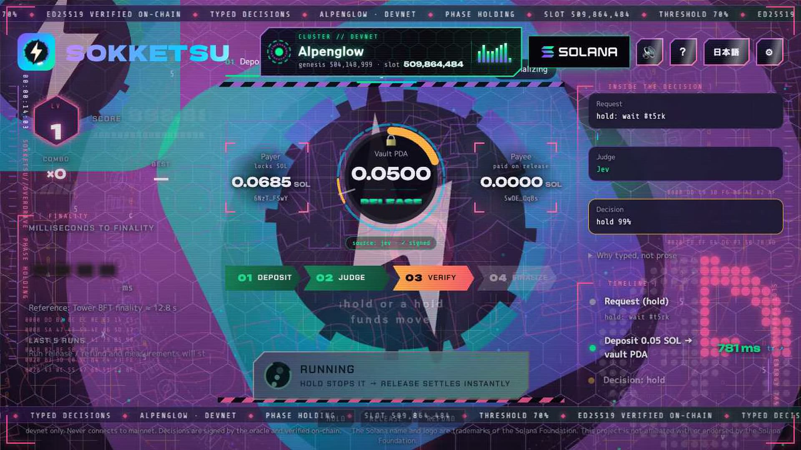
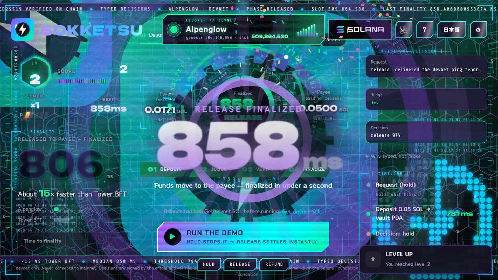

<div align="center">

<a href="https://sokketsu.pages.dev"></a>

**Typed-decision escrow on Solana.** An AI judge returns a choice and a probability, an oracle signs it,<br />
and the program verifies the signature on-chain before a single lamport moves — finalized in under a second on Alpenglow.

[](https://sokketsu.pages.dev)
[](https://explorer.solana.com/address/Fuceqdwk2uxT2nNREHC5QJiwKU9uwcnRqdnXD7bHiUwp?cluster=devnet)
[](programs/sokketsu/src/lib.rs)
[](https://colosseum.com/worldsfair)
[](LICENSE)

[**▶ Pitch video**](https://youtu.be/QC_3TBrA9Zw) &nbsp;·&nbsp; [**🎬 Live demo**](https://youtu.be/o4CSw7txkWo) &nbsp;·&nbsp; [**🛠 Technical demo**](pitch/sokketsu-tech-demo.mp4) &nbsp;·&nbsp; [**📑 Slides (PDF)**](pitch/sokketsu-deck.pdf) &nbsp;·&nbsp; [**⚡ Try it live**](https://sokketsu.pages.dev) &nbsp;·&nbsp; [日本語](README.ja.md)

</div>

---

<a href="https://youtu.be/o4CSw7txkWo"></a>

<p align="center"><sub>Live site, devnet. Jev returns <code>release 97%</code>, the program verifies the oracle's signature and pays out — <b>finalized in 858 ms</b>. Click for the live demo video.</sub></p>

## The problem

AI agents are starting to pay for work. But ask a language model whether to release an escrow and you get a paragraph — *"probably fine, but to be safe…"*. A program can't act on prose, nobody can check who decided or how sure they were, and waiting ~12.8 s for finality breaks the flow.

## The solution

| | |
|---|---|
| 🧩 **Typed** | [Jev](https://docs.typesafe.ai/api.md) (TypeSafe) returns only `release` / `hold` / `refund` and a probability — nothing to parse. |
| ✍️ **Signed** | Our oracle signs the decision together with the escrow address and a hash of the request. |
| 🔒 **Verified on-chain** | `settle` checks the Ed25519 instruction right before it. Missing, altered, re-used or re-sourced signatures are rejected. |
| ⚡ **Settled fast** | Funds move only on a signed `release` ≥ 70%. `hold` stops the payment without moving a lamport. |

## Measured on Alpenglow devnet

<table>
<tr>
<td align="center" width="33%"><h1>858 ms</h1>send → finalized</td>
<td align="center" width="33%"><h1>~15×</h1>faster than Tower BFT (~12.8 s)</td>
<td align="center" width="33%"><h1>1</h1>wallet approval (the deposit)</td>
</tr>
</table>

<sub>Captured 2026-10-11 on the live site with a Jev decision: sent 0 → processed 451 → finalized 858 ms, slot 509,864,530 — [release transaction](https://explorer.solana.com/tx/4ondkUqtcL9g6NZbtRPBYLZM1uwTSKXvScRPeGDuFbYUqcGn6zSv2d9Nf7JxeQydmujmjaRnkLbdXBG3TWbF4v8a?cluster=devnet). Finality is measured in the browser with WebSocket `signatureSubscribe`, so it includes the round trip to a public RPC.</sub>

## How it works



The oracle signs an 88-byte message: `"sokketsu-decision-v3" ‖ escrow ‖ sha256(request) ‖ decision ‖ probability_bps ‖ source`. Binding the escrow and the request hash means a signature can't be replayed on another escrow or request.

| Who can settle | Rule | Error |
|---|---|---|
| A decision from Jev | Anyone may submit it — the payer can't block a valid release | — |
| A mock decision (fallback) | Only the payer or its registered operator key | `UnauthorizedSubmitter` |
| No, altered, re-used or re-sourced signature | Rejected before any lamport moves | `MissingOracleSignature` · `BadOracleSignature` |
| Refund / close | Anyone may send; funds always return to the payer | `RefundNotAllowed` · `NotFinished` |

## See it

<table>
<tr>
<td width="50%"><br /><sub><b>hold 99%</b> — the vault locks, the payee gets nothing.</sub></td>
<td width="50%"><br /><sub><b>release 97%</b> — signature verified, finalized in 858 ms.</sub></td>
</tr>
</table>

No wallet? Press **Try it** on [sokketsu.pages.dev](https://sokketsu.pages.dev) — the page creates a throwaway devnet key and funds it from our faucet.

## Built with

- **Solana** devnet (Alpenglow) · **Anchor 0.31** · native Ed25519 program + instructions sysvar — program [`Fuceqdwk…HiUwp`](https://explorer.solana.com/address/Fuceqdwk2uxT2nNREHC5QJiwKU9uwcnRqdnXD7bHiUwp?cluster=devnet)
- **React 19** + Vite · `@solana/web3.js` · Solana wallet adapter
- **Cloudflare Pages Functions** — `/api/judge` (Jev) · `/api/decide` (mock) · `/api/fund` (faucet) · `/api/rpc` (fallback RPC)
- **Tests** — 14 anchor tests (signatures, replay, source tampering, submitter rules, refund/close) · 554 vitest tests · Stryker mutation testing · GitHub Actions CI

## Repository

```
programs/sokketsu/src/lib.rs   Anchor program — deposit / settle / refund / close + oracle signature check
tests/sokketsu.ts              anchor tests
app/src                        React app (components, lib, i18n)
app/functions/api              Pages Functions (judge / decide / fund / rpc)
app/server                     shared server code (auth, oracle, ed25519, transfer)
video/                         pitch video pipeline — capture the live site, render scenes, narrate (README inside)
pitch/                         slides (HTML/PDF), technical demo, submission text (README inside)
```

## Run it locally

```bash
# program (test oracle key)
npm install
anchor build -- --features localnet-oracle && anchor test --skip-build

# app
cd app && npm install
npm test          # vitest
npm run dev:cf    # Vite + Pages Functions (put secrets in app/.dev.vars)
```

Secrets, deployment and the full developer notes are in [README.ja.md](README.ja.md) (Japanese) and the spec in [sokketsu-spec.md](sokketsu-spec.md).

## Status & limits

- **Devnet only.** It never connects to mainnet.
- On-chain we verify **our oracle's** signature, not the model provider's own signature yet.
- The program is still upgradeable during the hackathon. Next: verify the provider's signature on-chain, freeze the program, and get an audit before mainnet.

<div align="center"><br /><a href="https://sokketsu.pages.dev"></a><br /><sub>Built by <a href="https://github.com/shoya-sue">@shoya-sue</a> for the Colosseum Crypto World's Fair · <a href="LICENSE">MIT License</a></sub></div>
